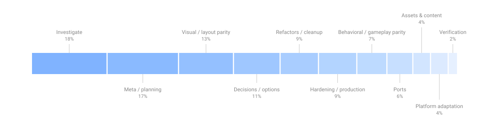

## Introduction
I published the final [Elevator CEO](/portfolio/elevator-ceo) iOS game to the App Store on January 9, 2015. I'm writing this 11 years later in a software development environment turned upside down because of generative artificial intelligence (Ai). In that time, and particularly since late 2025, it became clear that some skills are becoming more valuable while others are quickly fading into the background. As I narrate this journey, I'm going to highlight the key skills that will give us an edge over the new Ai machines, the large language models (LLMs).

  <a class="btn btn-primary btn-lg" href="/portfolio/elevator-ceo-web/play/" role="button">
    <i class="bi bi-play-circle me-2"></i>Play Elevator CEO
  </a>

## What Matters Now
LLMs can quickly and cheaply generate thousands of lines of code. They know the tools. They know the best practices. They don't get fatigued. Humans simply cannot compete on volume. LLMs also read faster and more accurately than humans. Given all that, where should we focus our skills? It comes back to judgment. These are the skills that feel durable in the age of Ai and software development:

- **The skill is knowing when to evaluate changes.** Ai has no sense of expediency and doesn't know what incrementalism means for your problem domain. Build your sense of "now feels right" and decide whether to dig deeper or move on.
- **The skill is knowing what "correct" means across different systems.** Ai can generate the code at scale but it can't decide what's right or wrong given incorrect, incomplete, or uncoordinated requests. Become the interpreter for an otherwise messy world.
- **The skill is knowing how to think creatively and laterally.** Ai computes in a world of probable outcomes. It will generate options all day, but it won't ask the counterintuitive question or know which unlikely option has merit. Asking unexpected questions, testing "what if" theories, and understanding we live in a world with tradeoffs are all valuable skills to develop.

The key is to build these skills through experience *within a problem domain*. Let's look at the framing of that domain, and how it has shifted.

## Coding is Not the Problem Domain
Just as a previous generation was told to "learn Mandarin" to gain an advantage in emerging markets, a new generation was told "learn to code". The idea was simple enough: *skill up!* Jobs are becoming more software-driven and manufacturing jobs scarcer, so the retraining that would offer the best [job security](/portfolio/job-security) would be software coding. The Google Trends for "[learn coding](https://trends.google.com/explore?q=learn%2520coding&date=all&geo=Worldwide)" shows a steady climb since the time [President Obama asked people to consider coding](https://www.youtube.com/watch?v=6XvmhE1J9PY "President Obama asks America to learn computer science") 13 years ago.

Then the COVID-19 pandemic decisively proved that coding workers were mobile and, therefore, their job output required only a computer and an internet connection. This seems ideal for a flexible workforce; however, almost any job matching that description can be done by Ai:

{% pullquote
    quote="Since the early 2010s, a parade of billionaires, tech executives and even U.S. presidents has urged young people to learn coding, arguing that the tech skills would help bolster students' job prospects as well as the economy. […] Computing graduates are feeling particularly squeezed because tech firms are embracing A.I. coding assistants, reducing the need for some companies to hire junior software engineers. ",
    persons="Natasha Singer",
    title="Goodbye, $165,000 Tech Jobs. Student Coders Seek Work at Chipotle.",
    url="https://www.nytimes.com/2025/08/10/technology/coding-ai-jobs-students.html?unlocked_article_code=1._VA.1ety.J1QbwLE23Oka&smid=url-share",
    publication="The New York Times",
    date="August 10, 2025",
    inset="2rem"
%}

If you managed to gain those skills, there's no guarantee you can keep the very job that requested them. If the pivot to "learn to blue collar" feels like whiplash, consider who's asking:

{% pullquote
    quote="Forget about learning to code. Meta Platforms says it's time to pick up a wrench. The company is starting a \"workforce academy\" to train Americans to build its data centers as skilled trade workers become a sought-after commodity.",
    persons="Meghan Bobrowsky and Te-Ping Chen",
    title="Meta Launches \"Workforce Academy\" to Train Workers to Build Data Centers",
    url="https://www.wsj.com/tech/ai/meta-launches-workforce-academy-to-train-workers-to-build-data-centers-35470a80?st=p7ziYX&reflink=desktopwebshare_permalink",
    publication="The Wall Street Journal",
    date="June 8, 2026",
    inset="2rem"
%}

Technology was introduced at human speed necessarily because we were the exclusive thinkers and builders. That's going to shift dramatically with Ai. Let's take keyboard typing speed as a skill. I remember my typing class from middle school and that training has served me well for 30 years, but learning it now is not value-added. The introduction of mobile phones with keyboards, predictive text, voice-to-text accuracy, and other tech has put steady, downward pressure on the skill's value.

It's common now to see Ai create hundreds of lines of code that are syntactically correct, runnable, and have a convincing polish. Two years ago it would have taken me days of thinking and typing. Although typing was a valuable job prerequisite, something fundamental changed because Ai didn't just diminish the value of code entry. The "coding" job is coordinating what the code *can* and *should* do in the problem domain. That job required skilled thinking to yield specially arranged keywords that, when executed, would solve a problem. The politicians, tech figureheads, and coding promoters couldn't foresee a time when machines would be able to replace not just typing but much of the thinking behind it.

If you've used coding agents then you might be aware of a `SKILL.md` file. It's made for LLMs and the premise is simple: describe what the skill does, when to use it, required or optional steps, the extra tools available, and what constraints to impose. The file's content is coding in natural language. The intent is to describe a process that isn't good enough "out of the box" with LLMs. So, is your problem domain safe? If job postings can't clearly articulate a job, capturing it in a file seems unlikely. For now.

## Evaluating Changes
Getting Elevator CEO ready for its rewrite didn't take long. It took less than 15 minutes to find the original source repositories and prep the Ai context—the collection of files used as the groundwork for a query. This is an underappreciated necessity of software development: organization. The *learn to code* dictum glosses over the periphery, which includes committing, tagging, and restoring the *essential* software you want from a particular point in time.

For Elevator CEO the first evaluation point with Ai was after only 90 minutes, at which time I said to the LLM "Let's start focusing on bugs." I committed to source control immediately before the bug hunt commenced. The prototype was good enough that I could pivot to a different phase. I think these narrative breaks with Ai are useful if you ever decide a project retrospective would add value to your work.

In this instance you might think it's the skill of using a Git repository, but that's not the skill. In the last 18-24 months I've seen Ai agents create solid commit messages, pull requests, and generally run circles around very experienced people with tooling knowledge. The skill bullet on your résumé that says "Git"? Ai can use it and in a lot of cases *better* than you.

**The skill is knowing when to evaluate changes.** The sheer volume of code, text, or content can be overwhelming if you consider it all equally. This is the classic volume, velocity, and variety problem. You'll quickly succumb to decision fatigue if every change is evaluated with equal brain energy, so skill up in ways that help you master this new reality. If you're on a deadline and need to decide when to stop building and deliver, or just have a grasp of what incrementalism means for your problem domain, both come down to developing the skill of "now feels right".

Admittedly, there's little data to support a feeling. But that's the case for human experience. If you believe the 10,000-hour heuristic for mastery, much of that time goes to building judgment and "feel," not just absorbing facts, rules, and how to apply them.

## Identifying "Correct"
The starting context for Elevator CEO was pretty basic: an existing repository of game source code, the matching game engine code, and the original music and graphics. The objective was to take native iOS code and use a new stack that allowed for greater portability. This meant changing from Objective-C, an Apple-specific language locked to iOS devices, and using instead TypeScript, a type-safe language that compiles to JavaScript that can be run on any web browser. Combined with [Babylon.js](https://github.com/BabylonJS/Babylon.js) as a suitable game engine replacement, I was ready to begin.

Even in these green days of Ai, the landscape reminds me of web search in the early 2000s. You type into a box and get output, and decent results are easy to come by regardless of which LLM you use. Don't like the answer? Switching costs are near zero. Search technology converged, and the winners were decided by brand and distribution, not by better results. I expect LLMs to follow the same path.

How did I prompt for my rewrite? No need for details up front. Keeping requirements loose proved effective:

  

    <i class="bi-chevron-right flex-shrink-0"></i>
    
I have a complete game I wrote in Objective-C using the cocos2d-iphone framework. The @ElevatorCEO folder contains all of my source code and binary assets (images and audio). The @cocos2d-iphone folder contains the source used at the time to render the game. My goal is to re-write the game in TypeScript using the @Babylon.js framework. The first step is take the game and lift it out of the past and into a modern framework and deploy first to the web. I want the focus of the work to be on conversion code from Objective-C to Typescript and the equivalent interfaces used by Babylon.

  

In other projects I've attempted highly detailed plan files and the process is still iterative. You *will not* get it right the first try. If your web search didn't work, what did you do? Go to the next page, and the next, or maybe a new search. The flow with Ai is very reminiscent of those days. You still need a goal in mind. A plan will set reasonable bounds so the LLM doesn't wander into irrelevant, less probable areas.

The LLM will build, modify, and iterate endlessly. Unit tests may add a degree of confidence but they don't substitute for implicit knowledge. If it's a rewrite and you have the background knowledge of the system, then you know what the system used to do. **The skill is knowing what "correct" means across different systems.**

The first bug I chased shows what that looks like in practice. The "PAUSED" text sat in the wrong spot, so I asked the LLM to check the legacy code for the correct position. It adjusted coordinates without finding the root cause, which was an entire pause layer class from the original that had never been ported. Once I pointed it to the exact line where the original centered the text, the text landed correctly, but the layer beneath it broke. The problem wasn't solved, only moved. Four prompts and thirty minutes is fast for bug elimination, but only because I knew how the screen should render and where to look in code I'd written eleven years earlier.

Audio, rendering, features, segues, and the platform for delivery all come with constraints for the problem domain. I want to deliver a game for the web that faithfully represents the version that was exclusive to iOS. Additional changes to address the uniqueness of the target platform included:
- removing obsolete iPhone 4 image ratios,
- omitting GameCenter and advertisement integration,
- saving to localStorage instead of user preferences, and
- reworking touch events and app lifecycle for the web.

Porting 7,989 lines of Objective-C and header files took 12 working days and roughly 51 hours, estimated from my prompt timestamps, spread across two calendar months. The original Elevator CEO took 16 months and, conservatively, ten times the hours, though that included far more than code and testing. The bigger difference is that in the original I was defining 'correct' as I went, with gameplay rules that existed only in my head. This time, the original game was the definition.

That implicit knowledge is an enormous advantage, especially when it blends expertise across different systems with complex interactions. There is still room for a human to offer valuable judgment in the process of building software.

## Think Creatively and Laterally
After the initial bootstrap it took 198 iterations with Ai to arrive at my definition of done. Those iterations aren't reflected in the Git log because they were squashed together to keep the record clean. Because the chat record exists apart from Git, I asked Ai to look at all 198 prompts and categorize them. The following breakdown shows that analysis.

<figure class="d-flex justify-content-center">
  
</figure>

Only a couple of years into Ai-centric workflows a pattern may be emerging, at least with Elevator CEO. I spot-checked the categories and they held up. Counting only prompts where I was deciding what to do or whether the result was right, rather than directing a change I'd already settled on, 66% of the work was judgment: investigating (18%), planning (17%), checking visual parity (13%), weighing options (11%), and checking gameplay parity (7%).

Domain and project experience play a part but asking grounded questions—even those that might seem counterintuitive—is the "art" in software development. **The skill is knowing how to think creatively and laterally.**

As the diagram illustrates, not every query was about bugs or features. Here are some of the queries that nudged in the direction I thought the code should go. I kept an open mind and let the LLM probabilities surface options I wouldn't have considered. The questions, however, and the choice of which answer to keep, were mine.

  

    <i class="bi-chevron-right flex-shrink-0"></i>
    
Would a wrapper be best or convert the code to the true Babylon interfaces?

  

  

    <i class="bi-chevron-right flex-shrink-0"></i>
    
For the vertical gaps along the top and bottom of my game… what could I place to fill them? Suggestions only.

  

  

    <i class="bi-chevron-right flex-shrink-0"></i>
    
Scene inheritance is a little messy simply for the purposes of a menu - what about composition instead? Create a plan for that approach.

  

  

    <i class="bi-chevron-right flex-shrink-0"></i>
    
The idea of placeholder images is interesting… How might that be implemented, broadly speaking?

  

An unexpected benefit of Ai has been to have an always-on opinion generator when you feel uninspired. Having non-deterministic answers to open-ended questions can be great for brainstorming ideas. Choosing the worthy idea is still a human job.

## Conclusion
I hope you enjoy the web-based version of Elevator CEO. I had fun making the original and remaking this one, though it took only a fraction of the time with Ai. Gaming and fun aside, the question many people in my industry are asking is existential: *What is my purpose?* By contrast, my colleagues from different areas adjacent to coding are more sanguine because their identity was less about *producing* software and more about *using* software. What opened up for a general audience was the ability to wield tools that previously took years to gain proficiency. Now anyone can converse at a human level with Ai to create software.

Making sense of a problem almost always starts with a question or hypothesis. Humans will still be hired based upon the facts they know, but the most enduring career skill will be demonstrated judgment in a problem domain. What can't be embedded into a `SKILL.md` file, documented in code, or trained into an LLM with massive data sets leaves room for the human. We must investigate, plan, use our senses, and weigh options for the world we make for ourselves.
